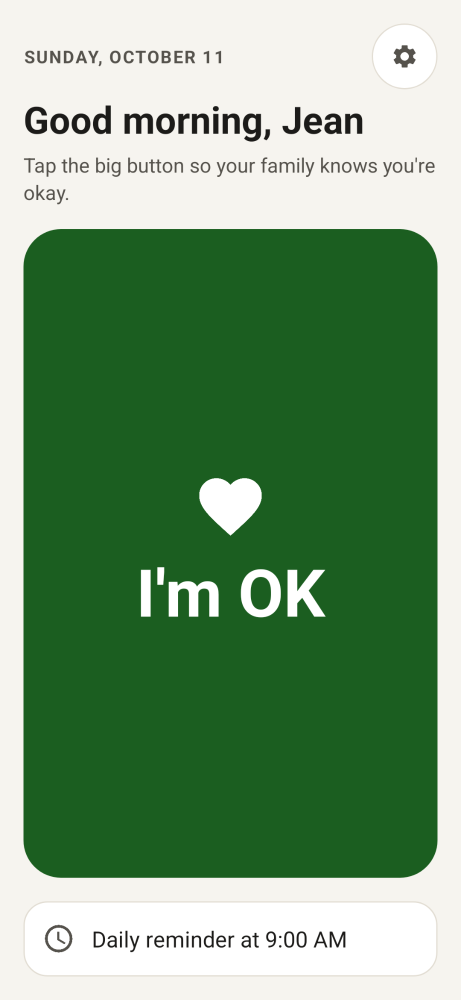
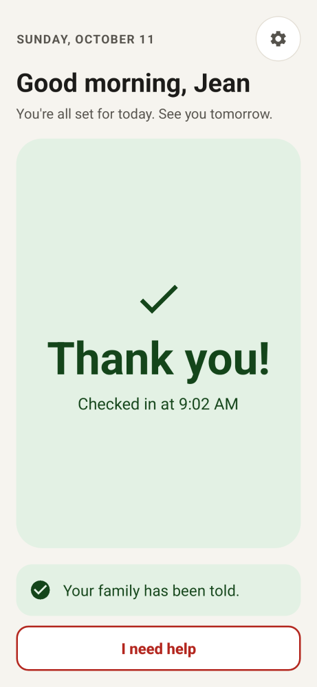
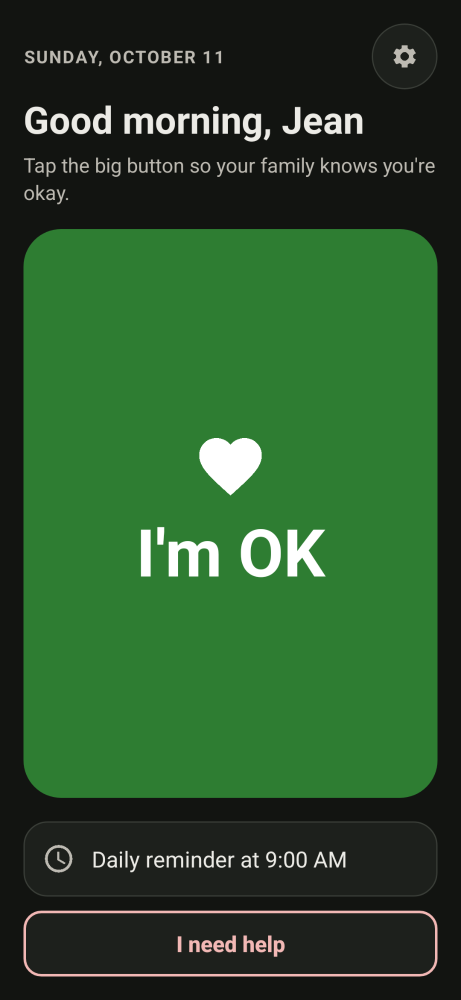
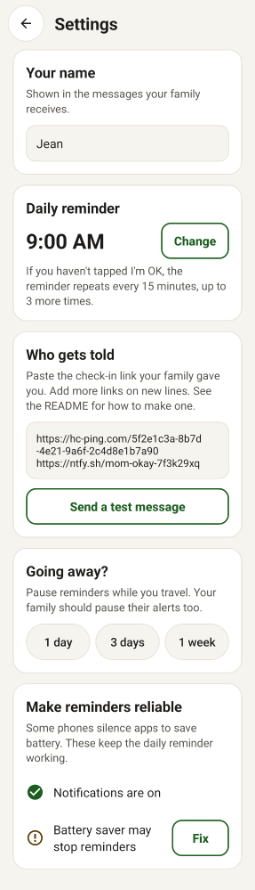

# Are You Okay?

A tiny Android app for one daily "I'm OK" check-in. One giant green button. A
daily reminder. If the check-in doesn't arrive, a free monitoring service
alerts the family. No accounts, no servers to run, no SMS fees, no tracking.

The idea came from a 74-year-old mom who wanted her daughter to know she is
okay every day.

<p>
  
  
  
  
</p>

## How it works

```
 Mom's phone                         Free services                    Family
 ───────────                         ─────────────                    ──────
 9:00  reminder notification
       (repeats every 15 min, 3x)
 tap   [ I'M OK ] ───── POST ─────▶  Healthchecks.io  ── no ping by ──▶ email / Signal /
                         │           (dead-man's switch)   deadline     Telegram / ntfy
                         └── POST ─▶ ntfy.sh (optional) ─── every ───▶ "Mom checked in ✓"
                                                            check-in    push notification
```

**The important design choice:** the *missed* check-in alert is sent by a
server, not by Mom's phone. If her phone is off, dead, broken, or she fell
and can't reach it, the phone can't send anything. That's exactly when the
alert matters most, so a phone-only design fails when you need it.
[Healthchecks.io](https://healthchecks.io) is a "dead man's switch": it
expects a ping on a schedule and alerts you when one doesn't arrive. The free
plan covers 20 checks and many alert channels (email, Signal, Telegram, ntfy,
Pushover, Discord, Slack, and more). It is also
[open source](https://github.com/healthchecks/healthchecks), so you can
self-host it.

## Setup (about 10 minutes)

### 1. The family member: create the alert

1. Sign up at https://healthchecks.io (free).
2. **Add Check** and name it "Mom daily check-in".
3. Set the **Schedule** to **Cron**, enter `0 0 * * *` (midnight every day), and pick Mom's **time zone**.
   Set **Grace time** to the hour by which you'd worry, e.g. **11 hours** means "alert me if she
   hasn't checked in by 11:00 AM". Any check-in after midnight counts for that day.
   (Don't set the cron to the reminder time, like `0 9 * * *`. A check-in at 8:30 would then
   count for the day before and cause a false alarm.) If she checks in late, Healthchecks sends a
   second "back up" message, so you also hear when she's fine.
4. Under **Integrations**, add how you want to be alerted: email is already on.
   Signal, Telegram, or the ntfy app give a phone push.
5. Copy the check's **ping URL** (it looks like `https://hc-ping.com/1234abcd-...`).

> The check starts in the "new" state and only begins watching after the first ping,
> so nothing alerts until Mom's first tap.

### 2. Optional: get a notification on every check-in

Install the free [ntfy](https://ntfy.sh) app on your phone and subscribe to a
hard-to-guess topic name, e.g. `mom-okay-7f3k29xq`. The link to add in the app
is `https://ntfy.sh/mom-okay-7f3k29xq`. Topic names on ntfy.sh are public to
anyone who knows them, so make it random.

### 3. Mom's phone: install the app

1. Download `app-debug.apk` (from this repo's **Actions** tab, or a Release) to the phone.
2. Open it. Android will ask to allow installs from the browser or files app. Allow it, then tap **Install**.
   (Play Protect may warn that the app is unknown. Choose **Install anyway**.)
3. Open **Are You Okay?** and allow notifications.
4. **Text Mom the link(s).** On her phone she presses and holds the link in Messages, taps
   **Share**, and picks **Are You Okay?**. The app shows where check-ins will go and asks
   "Add this link?" (Or copy the link and tap **Paste link** in Settings.)
5. In **Settings**:
   - **Your name**: shown in the messages.
   - **Daily reminder**: a couple of hours before your alert deadline (e.g. 9:00 for an 11:00 deadline).
   - Check that the links are described as "Alerts your family if you miss a check-in" (Healthchecks)
     and "Tells your family each time you check in" (ntfy), then tap **Send a test message**.
   - Under **Make reminders reliable**, tap **Fix** on anything with a warning, especially
     battery saving on Samsung, Xiaomi and similar phones. See https://dontkillmyapp.com for your model.
6. Optional: long-press the home screen > **Widgets** > **Are You Okay?** to add a big
   "I'm OK" button to her home screen.

### Going away?

Mom can pause reminders in Settings. On Healthchecks.io the family clicks
**Pause** on the check. A paused check resumes automatically on Mom's next
check-in, so there's nothing to remember to turn back on.

## Web version (iPhone, or no install)

`web/` is the same check-in as a web page you can add to the home screen. It works on
iPhone and Android, and uses the same Healthchecks.io and ntfy links.

- **`/family`**, for you: fill in her name, the Healthchecks ping URL (checked live, so a
  typo is caught before you send it) and an ntfy topic. You get **one personal link**.
  The page also lists her recent check-ins from ntfy.
- **`/`**, for her: open the personal link once and she's set up. The settings travel in the
  link's `#fragment`, which browsers never send to the server, and are then kept only on her phone.
  The same link also sets up the Android app: press and hold it in Messages, tap Share, then choose Are You Okay?.
- Same big **I'm OK** button, **I need help**, offline queue, dark mode, and an "Add to Home Screen" install.
- **Limit:** a web page can't remind her at 9:00 every day. Use the Android app for that,
  or a daily alarm in the phone's Clock app.

### Put it on Vercel (free, about 2 minutes)

1. Go to https://vercel.com/new and import this GitHub repository.
2. Set **Root Directory** to `are-you-okay/web`, set **Framework Preset** to **Other**, and leave the build command empty.
3. Click **Deploy**. Each push afterwards redeploys it automatically.
4. Open `https://<your-project>.vercel.app/family` to make her link.

Vercel serves only the production branch publicly. Branch "preview" links ask visitors to log
in to Vercel, so make sure the version she uses is on the production branch (normally `main`).
`vercel.json` adds strict security headers: a CSP, no referrer, and no camera, microphone or location access.

Test it: `cd web-tests && npm ci && npx playwright install chromium && npm test`. This runs the whole
flow (family setup, her link, check-in, help, offline, mistyped link) in a phone-sized
browser with Vercel's headers, and saves screenshots.

## What the app does (and doesn't)

- **One big button.** White on dark green (about 8:1 contrast), a heart icon, and a calm
  "Thank you!" state afterwards. Works with large text, dark mode, landscape, tablets and TalkBack.
- **Several ways to check in:** the app, the **I'm OK** button on the reminder notification,
  a **home-screen widget**, or long-press the app icon > **I'm OK**.
- **Daily reminder** at a set time. It repeats every 15 minutes, 3 more times, until she taps.
  Checking in earlier in the day skips it. Reminders survive restarts, updates and time-zone changes.
- **"I need help"** (smaller, below the main button, always asks first): sends an urgent alert.
  Healthchecks.io gets its `/fail` signal and alerts the family immediately; ntfy gets
  top priority. It does **not** call emergency services, and says so.
- **Status in plain words:** "Your family has been told", "Telling your family…",
  "No internet right now, will send when back online", "One of your family's links didn't work",
  "Reminders are turned off. Tap here to fix."
- **Offline-safe:** messages wait (Android JobScheduler) and send when the phone reconnects.
  A link that answers "not found" isn't retried forever; it's flagged instead.
- **Going away?** One-tap pause for 1 day, 3 days or 1 week.
- **Permissions:** notifications, exact alarm, start on boot, internet, battery-optimization request.
  **No** SMS, location, contacts, accounts or Google Play Services. No analytics. Settings stay on the phone.
- **Tiny:** no third-party libraries in the app; the release APK is about 76 KB.

## Why not…

| Option | Why we didn't use it (for v1) |
| --- | --- |
| **SMS from the phone** | Google Play blocks `SEND_SMS` for apps that aren't the default SMS app. Android 15+ marks it as a "restricted setting" for sideloaded apps. And the phone that should send the alert may be the one that's dead. |
| **SMS via Twilio etc.** | Needs a paid account, A2P 10DLC registration in the US, and a server. Healthchecks.io can do SMS/WhatsApp on paid plans if you really need it. |
| **PWA (web app) only** | Easiest to share, and works on iPhone, so it's included (`web/`). But a web page can't reliably fire a local reminder at 9:00 every day (the Notification Triggers API was abandoned) without a push server, so the Android app stays the main path on Android. |
| **Full-screen alarm** | Android 14+ only grants full-screen intents to alarm/calling apps. A high-priority notification that repeats is enough, and less alarming. |
| **Location sharing** | Adds permissions and complexity. Google Maps "Location sharing" or Life360 already do this well. |

## Build it yourself

Requires JDK 17+ and the Android SDK (or Android Studio: *Open* this folder and press Run).

```bash
cd are-you-okay
./gradlew assembleDebug
# APK: app/build/outputs/apk/debug/app-debug.apk
```

Tests (no emulator needed):

```bash
./gradlew testDebugUnitTest      # unit tests + screenshot rendering
./gradlew recordPaparazziDebug   # regenerate the screenshots in app/src/test/snapshots
```

The screenshot tests ([Paparazzi](https://github.com/cashapp/paparazzi)) render every
main-screen state, settings, the widget, dark mode, 200% text, landscape and tablet.

Each push that changes `are-you-okay/` runs the tests and builds the APK on GitHub Actions
(`.github/workflows/are-you-okay.yml`). Download it from the run's **Artifacts**.

**About signing:** debug APKs built on different machines are signed with
different keys. Android won't install an update signed by a different key, so
you'd have to uninstall first and re-enter the settings. To get updates that
install over each other, make one release keystore and add these repository
secrets: `AYO_KEYSTORE_BASE64`, `AYO_KEYSTORE_PASSWORD`, `AYO_KEY_ALIAS`,
`AYO_KEY_PASSWORD`. The workflow then also builds a signed `app-release.apk`.

## Code map

| File | What it does |
| --- | --- |
| `MainActivity.kt`, `MainScreen.kt` | The big button, help button and today's status (screen drawn from a plain `State`) |
| `SettingsActivity.kt`, `SettingsScreen.kt` | Name, time, links (share/paste), pause, test, reliability checklist |
| `Reminders.kt` | Daily alarm, 15-minute repeats, midnight reset, notifications |
| `CheckIn.kt` | Records a check-in or help request and POSTs it to the links |
| `SendJobService.kt` | Delivers messages, waiting for network if needed |
| `OkWidget.kt` | Home-screen widget |
| `Links.kt`, `Schedule.kt` | Link recognition and date math (pure Kotlin, unit-tested) |
| `ReminderReceiver.kt`, `BootReceiver.kt` | Alarm, notification-button, and reboot hooks |
| `Prefs.kt` | All saved state |

## Roadmap ideas (good first contributions)

- Daily reminders for the web version (Web Push from a scheduled function).
- Choose the number and spacing of reminders in Settings.
- Show a short history of recent check-ins.
- A check-in history page for the family (Healthchecks.io already keeps one per check).
- In-app pause that also pauses the Healthchecks check (needs a Healthchecks API key).
- Translations (all text is in `res/values/strings.xml`).
- Publish on F-Droid.

## License

MIT. See `LICENSE`.
